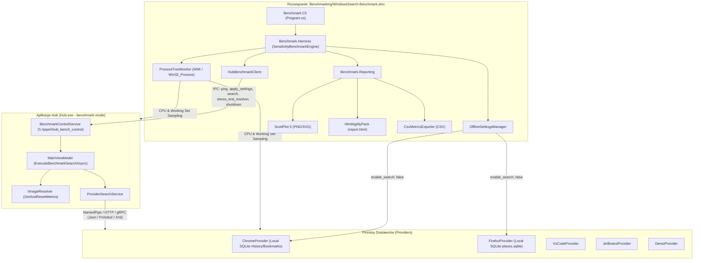

# Przewodnik po Aplikacji Benchmarkującej (Benchmark Guide)

Aplikacja benchmarkująca służy do precyzyjnego pomiaru wydajności systemu wyszukiwania **WindowsSearch (Hub + Providers)** na potrzeby pracy magisterskiej. Umożliwia ona profilowanie i porównywanie różnych konfiguracji (transporty, formaty serializacji, tryby współbieżności Huba, strategie cache'owania ikon) w kontrolowanym środowisku offline (bez udziału zapytań internetowych).

---

## 1. Architektura Systemu



---

## 2. Podział Projektów w Rozwiązaniu `WindowsSearch.Benchmark.slnx`

1. **`WindowsSearch.Benchmark.Core`**:
   - Silnie typowane modele konfiguracji (`BenchmarkConfiguration`), próbek sprzętowych (`SystemResourceSample`), pojedynczych przebiegów (`SingleRunBenchmarkResult`), podsumowań statystycznych (`ConfigurationBenchmarkSummary`), wyników czułości (`SensitivityBenchmarkResult`) i miar statystycznych (`MetricStatistics`).
   - Współdzieli bezpośrednio kontrakty enumów z `Shared/WindowsSearch.Common` (`ProviderTransportKind`, `SerializationKind`, `ProviderSearchMode`, `ImageResolverKind`). Dodanie nowej wartości do enuma automatycznie włącza ją do benchmarku przez `Enum.GetValues<T>()`.
2. **`WindowsSearch.Benchmark.Harness`**:
   - `SensitivityBenchmarkEngine`: koordynuje 5-etapowy proces analizy wrażliwości (OFAT) oraz wieloaspektowe porównanie Best vs Worst.
   - `HubBenchmarkClient`: klient potoku nazwanego sterujący aplikacją Hub w czasie rzeczywistym.
   - `ProcessTreeMonitor`: próbkuje drzewo procesów Hub + wszystkie procesy potomne dostawców (CPU %, Working Set MB, Private Memory MB).
   - `OfflineSettingsManager`: zabezpiecza testy przed wpływem sieci - tworzy kopie zapasowe `settings.yaml` i wymusza `enable_search: false` dla Chrome i Firefox, przywracając oryginały po zakończeniu.
   - `StatisticalCalculator`: oblicza średnią, medianę (P50), percentyle P90/P95/P99, odchylenie standardowe, 95% margines błędu oraz filtrację wartości odstających za pomocą reguły rozstępu ćwiartkowego (Tukey IQR).
3. **`WindowsSearch.Benchmark.Reporting`**:
   - `ChartGenerator`: generuje publikacyjne wykresy wektorowe SVG i rastrowe PNG przy użyciu biblioteki **ScottPlot 5** (wykresy z wąsami błędu 95% CI, wykresy podwójnoosiowe dla zasobów CPU/RAM, rozbicie na dostawców, mikro-zbliżenie na resolwery in-memory).
   - `HtmlReportGenerator`: tworzy nowoczesny dashboard HTML w zbalansowanym układzie 2-kolumnowym za pomocą **HtmlAgilityPack**.
   - `CsvMetricsExporter` & `JsonMetricsExporter`: eksportują surowe dane i podsumowania do CSV i JSON.
4. **`WindowsSearch.Benchmark.Cli`**:
   - Aplikacja konsolowa przyjmująca parametry linii poleceń (`--runs`, `--warmup`, `--queries`, `--limit`, `--output`, `--regenerate`).
5. **`WindowsSearch.Benchmark.Tests`**:
   - Testy jednostkowe dla kalkulatora statystyk (w tym filtracji IQR), eksportera CSV oraz menedżera ustawień offline.

---

## 3. Protokół Komunikacji Sterującej (IPC Control Pipe)

Hub uruchamiany jest z flagą:
```bash
Hub.exe --benchmark-mode hub_bench_control
```

Aplikacja benchmarkująca komunikuje się z Hubem przez dedykowany potok nazwany `\\.\pipe\hub_bench_control` za pomocą komend JSON:

- **`ping`**:
  ```json
  { "action": "ping" }
  ```
  Zwraca PID Huba w celu monitorowania zasobów systemowych.
- **`apply_settings`**:
  ```json
  {
    "action": "apply_settings",
    "transportKind": 0,
    "serializationKind": 0,
    "searchMode": 2,
    "imageResolverKind": 2,
    "useCache": true
  }
  ```
  Dynamicznie przestawia transport, serializację, tryb Huba i resolver ikon bez konieczności restartu całego środowiska.
- **`search`**:
  ```json
  {
    "action": "search",
    "query": "git",
    "limit": 5,
    "bypassDebounce": true,
    "runId": "run_1"
  }
  ```
  Uruchamia proces wyszukiwania w Hubie, mierzy moment pojawienia się pierwszej kategorii (`timeToFirstResultMs`), czeka na zakończenie wszystkich dostawców i załadowanie ikon w UI, a następnie zwraca szczegółowy raport telemetryczny:
  ```json
  {
    "action": "search",
    "success": true,
    "processId": 1234,
    "report": {
      "runId": "run_1",
      "query": "git",
      "totalWallClockMs": 14.8,
      "timeToFirstResultMs": 1.2,
      "transportKind": 0,
      "serializationKind": 0,
      "searchMode": 2,
      "totalAggregationMs": 0.4,
      "totalImageResolutionMs": 1.2,
      "providerMetrics": [
        {
          "providerName": "DemoProvider",
          "requestSerializationMs": 0.2,
          "requestPayloadBytes": 110,
          "transportRoundtripMs": 8.5,
          "providerExecutionMs": 7.1,
          "responseDeserializationMs": 0.3,
          "responsePayloadBytes": 350,
          "aggregationMs": 0.1,
          "itemCount": 5,
          "categoryCount": 1,
          "success": true
        }
      ],
      "imageResolverMetrics": {
        "resolverKind": "ConcurrentDictionaryImageResolver",
        "useCache": true,
        "imagesRequested": 12,
        "cacheHits": 10,
        "cacheMisses": 2,
        "totalResolveTimeMs": 1.2
      },
      "success": true
    }
  }
  ```
- **`stress_test_resolver`**:
  ```json
  { "action": "stress_test_resolver" }
  ```
  Wymusza odpytanie resolwera ikon o wszystkie zainstalowane aplikacje systemowe Windows (z `AppIndexService`, 60–120+ plików `.exe` i `.ico`), umożliwiając test wydajnościowy w stanie zimnym (Cold Start) oraz ustabilizowanym (Warm Steady-State).

- **`reset_caches`**:
  ```json
  { "action": "reset_caches" }
  ```
  Czyści pamięć podręczną aplikacji `InstalledApps` w Hubie, unieważnia i ponownie inicjalizuje instancję `imageResolver` oraz wywołuje odśmiecanie pamięci GC bez niepotrzebnego restartu procesów dostawców (co zapobiega stanom `TIME_WAIT` i narzutowi startowemu OS). Umożliwia to precyzyjny pomiar kosztu zimnego startu (Cold Start) dla każdej badanej konfiguracji.
- **`shutdown`**:
  ```json
  { "action": "shutdown" }
  ```
  Bezpiecznie zamyka instancję Huba i czyści zasoby.

---

## 4. Układ Raportu HTML (2-Kolumnowy Dashboard)

Każda karta etapu w pliku `report.html` zbudowana jest w zbalansowanym, czytelnym układzie kafelkowym (dwu- lub trzykolumnowym):

| Kolumna Lewa (Wydajność & Czas) | Kolumna Środkowa / Dodatkowa | Kolumna Prawa (Zasoby Systemowe & Architektura) |
| :--- | :--- | :--- |
| **Etap 1**: Zysk NamedPipe vs HTTP & gRPC (% szybsze per provider), Czysty czas wywołania dostawcy (Zoom) & Porównanie z czasem całkowitym (Amdahl's Law) | - | **Etap 1**: Wykres zasobów (CPU %, Working Set & Private Memory MB) oraz **Macierz Zysku IPC Dostawców** |
| **Etap 2**: Rozmiar ramek na łączu (Bajtów) & Czas CPU serializacji (ms) | - | **Etap 2**: Wykres zasobów CPU, Working Set i Private Memory per format serializacji |
| **Etap 3**: Czas pierwszego wyniku (TTFR) vs Sumaryczna latencja & Rozbicie na dostawców (Prawo Amdahla) | - | **Etap 3**: Wykres zasobów CPU, Working Set i Private Memory per tryb współbieżności |
| **Etap 4**: Makro-kara braku cache & Mikro-zbliżenie na struktury in-memory pod obciążeniem | - | **Etap 4**: Liczba trafień i chybień (Hits vs Misses) & Zużycie pamięci resolwerów |
| **Etap 5**: Porównanie Best vs Worst (Czas całkowity oraz czas TTFR) | **Etap 5**: **Wykres Kołowy Budżetu Czasowego (Amdahl's Law Pie Chart)**: podział na pracę bazy danych, transport IPC, serializację, agregację i ikony | **Etap 5**: Delta zasobów sprzętowych (CPU %, Working Set & Private Memory MB) Best vs Worst |

Pod wykresami w każdym etapie umieszczona jest **kompletna 26-kolumnowa tabela danych**:
`Tag`, `Transport`, `Serialization`, `Search Mode`, `Image Resolver`, `Cache`, `Tries`, `Cold (ms)`, `Mean (ms)`, `Filtered (ms)`, `Outliers`, `TTFR (ms)`, `Median (ms)`, `P95 (ms)`, `StdDev`, `Avg Prov (ms)`, `Ser CPU (ms)`, `Agg (ms)`, `Img Res (ms)`, `Total Wire`, `CPU %`, `Hub WS (MB)`, `Total WS (MB)`, `Hub Priv (MB)`, `Total Priv (MB)`, `Cache Hits`, `Cache Misses`, `Hit Rate %`.

> **Uwaga Badawcza dot. Pamięci RAM**: Wskaźnik `Working Set` sumuje strony pamięci wszystkich procesów, w tym współdzielone pliki DLL bibliotek bazowych .NET 10 (co sztucznie zawyża wynik do $\approx 500\text{ MB}$). Wskaźnik `Private Memory` (`Commit Charge`) reprezentuje rzeczywistą pamięć unikalną zaalokowaną na stertach procesów ($\approx 240\text{–}280\text{ MB}$), co stanowi dowód empiryczny na potrzeby pracy magisterskiej.

## 5. Jak Uruchomić Benchmark

### Krok 1: Zbudowanie wersji Release (Wymagane jednorazowo)
```powershell
powershell -File scripts/Build-Release.ps1
```

### Krok 2: Uruchomienie pełnego benchmarku z zapisem do katalogu z datownikiem
```powershell
dotnet run --project Benchmarking/WindowsSearch.Benchmark.Cli/WindowsSearch.Benchmark.Cli.csproj -c Release -- `
    --warmup 2 `
    --runs 4 `
    --queries git,fire,test `
    --output ./thesis-sensitivity-results `
    --hub-path ./Hub/bin/Release/net10.0-windows/Hub.exe
```
> Wyniki automatycznie zapisywane są w podfolderze z dokładnym znacznikiem czasu startu (np. `thesis-sensitivity-results/2026-10-11_17-30-00/`).

### Błyskawiczna regeneracja raportu HTML i wykresów (~2 sekundy bez uruchamiania testów)
Jeśli w przyszłości zechcesz zmienić style CSS, czcionki, kolory wykresów czy układ raportu do pracy magisterskiej, **nie musisz ponownie uruchamiać testów**:
```powershell
dotnet run --project Benchmarking/WindowsSearch.Benchmark.Cli/WindowsSearch.Benchmark.Cli.csproj -- `
    --regenerate ./thesis-sensitivity-results
```
Program automatycznie wczyta plik `benchmark_results.json` i natychmiast wygeneruje zaktualizowany plik `report.html` oraz wszystkie wykresy PNG/SVG.
