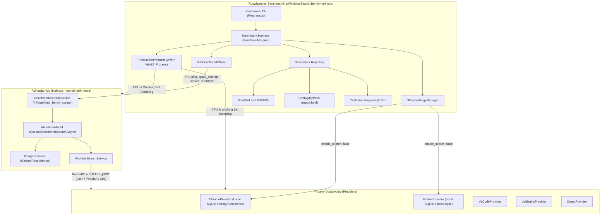

# Przewodnik po Aplikacji Benchmarkującej (Benchmark Guide)

Aplikacja benchmarkująca służy do precyzyjnego pomiaru wydajności systemu wyszukiwania **WindowsSearch (Hub + Providers)** na potrzeby pracy magisterskiej. Umożliwia ona profilowanie i porównywanie różnych konfiguracji (transporty, formaty serializacji, tryby współbieżności Huba, strategie cache'owania ikon) w kontrolowanym środowisku offline (bez udziału zapytań internetowych).

---

## 1. Architektura Systemu



---

## 2. Podział Projektów w Rozwiązaniu `WindowsSearch.Benchmark.slnx`

1. **`WindowsSearch.Benchmark.Core`**:
   - Silnie typowane modele konfiguracji (`BenchmarkConfiguration`), próbek sprzętowych (`SystemResourceSample`), pojedynczych przebiegów (`SingleRunBenchmarkResult`), podsumowań statystycznych (`ConfigurationBenchmarkSummary`) i miar statystycznych (`MetricStatistics`).
   - Współdzieli bezpośrednio kontrakty enumów z `Shared/WindowsSearch.Common` (`ProviderTransportKind`, `SerializationKind`, `ProviderSearchMode`, `ImageResolverKind`). Dodanie nowej wartości do enuma automatycznie włącza ją do benchmarku przez `Enum.GetValues<T>()`.
2. **`WindowsSearch.Benchmark.Harness`**:
   - `BenchmarkEngine`: koordynuje macierz testów, rozgrzewkę (warmup), próby pomiarowe oraz obliczenia statystyczne.
   - `HubBenchmarkClient`: klient potoku nazwanego sterujący aplikacją Hub w czasie rzeczywistym.
   - `ProcessTreeMonitor`: próbkuje drzewo procesów Hub + wszystkie procesy potomne dostawców (CPU %, Working Set MB, Private Memory MB).
   - `OfflineSettingsManager`: zabezpiecza testy przed wpływem sieci - tworzy kopie zapasowe `settings.yaml` i wymusza `enable_search: false` dla Chrome i Firefox, przywracając oryginały po zakończeniu.
   - `StatisticalCalculator`: oblicza średnią, medianę (P50), percentyle P90/P95/P99, odchylenie standardowe i 95% margines błędu.
3. **`WindowsSearch.Benchmark.Reporting`**:
   - `ChartGenerator`: generuje publikacyjne wykresy wektorowe SVG i rastrowe PNG przy użyciu biblioteki **ScottPlot 5** (wykresy słupkowe z wąsami błędu 95% CI dla transportów, porównanie trybów wyszukiwania, rozmiary wiadomości na łączu, porównanie cache'owania ikon).
   - `HtmlReportGenerator`: tworzy interaktywny, samodzielny raport HTML z tabelami za pomocą **HtmlAgilityPack**.
   - `CsvMetricsExporter` & `JsonMetricsExporter`: eksportują surowe dane i podsumowania do CSV i JSON.
4. **`WindowsSearch.Benchmark.Cli`**:
   - Aplikacja konsolowa przyjmująca parametry linii poleceń (`--runs`, `--warmup`, `--queries`, `--limit`, `--output`, `--quick`).
5. **`WindowsSearch.Benchmark.Tests`**:
   - Testy jednostkowe dla kalkulatora statystyk, eksportera CSV oraz menedżera ustawień offline.

---

## 3. Protokół Komunikacji Sterującej (IPC Control Pipe)

Hub uruchamiany jest z flagą:
```bash
Hub.exe --benchmark-mode hub_bench_control
```

Aplikacja benchmarkująca komunikuje się z Hubem przez dedykowany potok nazwany `\\.\pipe\hub_bench_control` za pomocą komend JSON:

- **`ping`**:
  ```json
  { "action": "ping" }
  ```
  Zwraca PID Huba w celu monitorowania zasobów systemowych.
- **`apply_settings`**:
  ```json
  {
    "action": "apply_settings",
    "transportKind": 0,
    "serializationKind": 0,
    "searchMode": 2,
    "imageResolverKind": 2,
    "useCache": true
  }
  ```
  Dynamicznie przestawia transport, serializację, tryb Huba i resolver ikon bez konieczności restartu całego środowiska.
- **`search`**:
  ```json
  {
    "action": "search",
    "query": "git",
    "limit": 25,
    "bypassDebounce": true,
    "runId": "run_1"
  }
  ```
  Uruchamia proces wyszukiwania w Hubie, czeka na zakończenie wszystkich dostawców i załadowanie ikon w UI, a następnie zwraca szczegółowy raport telemetryczny:
  ```json
  {
    "action": "search",
    "success": true,
    "processId": 1234,
    "report": {
      "runId": "run_1",
      "query": "git",
      "totalWallClockMs": 14.8,
      "transportKind": 0,
      "serializationKind": 0,
      "searchMode": 2,
      "totalAggregationMs": 0.4,
      "totalImageResolutionMs": 1.2,
      "providerMetrics": [
        {
          "providerName": "DemoProvider",
          "requestSerializationMs": 0.2,
          "requestPayloadBytes": 110,
          "transportRoundtripMs": 8.5,
          "providerExecutionMs": 7.1,
          "responseDeserializationMs": 0.3,
          "responsePayloadBytes": 350,
          "aggregationMs": 0.1,
          "itemCount": 5,
          "categoryCount": 1,
          "success": true
        }
      ],
      "imageResolverMetrics": {
        "resolverKind": "ConcurrentDictionaryImageResolver",
        "useCache": true,
        "imagesRequested": 12,
        "cacheHits": 10,
        "cacheMisses": 2,
        "totalResolveTimeMs": 1.2
      },
      "success": true
    }
  }
  ```
- **`shutdown`**:
  ```json
  { "action": "shutdown" }
  ```
  Bezpiecznie zamyka instancję Huba i czyści zasoby.

---

## 4. Etapy Pomiarowe w Kodzie

Każde zapytanie rozkłada czas wykonania na składowe:
1. **$t_{req\_ser}$**: czas serializacji zapytania w Hubie (NamedPipe / HTTP / gRPC).
2. **$t_{ipc}$**: czas przesyłu i buforowania danych w warstwie IPC systemu Windows.
3. **$t_{provider\_exec}$**: czysty czas wyszukiwania w procesie dostawcy (`resultFinder.FindAsync`), mierzony wewnątrz `BaseProviderHost`.
4. **$t_{resp\_deser}$**: czas deserializacji odpowiedzi w Hubie.
5. **$t_{aggregation}$**: czas grupowania, sortowania według wag i mapowania modeli na struktury UI w Hubie.
6. **$t_{image\_resolve}$**: czas rozwiązania ikon dostawców i wyników (`IImageResolver.ResolveAsync`), z rozbiciem na trafienia (cache hit) i chybienia (cache miss).

---

## 5. Jak Uruchomić Benchmark

### Szybki przebieg weryfikacyjny (Smoke Test):
```bash
dotnet run --project Benchmarking/WindowsSearch.Benchmark.Cli/WindowsSearch.Benchmark.Cli.csproj -- --quick
```

### Pełny zestaw testów do pracy magisterskiej:
```bash
dotnet run --project Benchmarking/WindowsSearch.Benchmark.Cli/WindowsSearch.Benchmark.Cli.csproj -- --warmup 5 --runs 30 --output ./thesis-benchmark-results
```

Wyniki, wykresy SVG/PNG oraz plik `report.html` zostaną zapisane w podanym katalogu wyjściowym.
