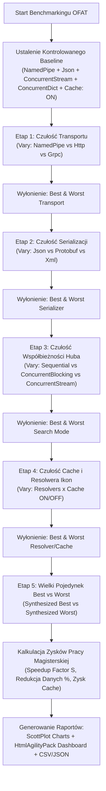

# Metodologia Badawcza Benchmarkingu (Benchmarking Methodology)

Niniejszy dokument opisuje rygorystyczną metodologię eksperymentalną przeprowadzenia testów wydajnościowych systemu wyszukiwania **WindowsSearch (Hub + Providers)** na potrzeby pracy magisterskiej.

---

## 1. Problem Eksplozji Kombinatorycznej i Uzasadnienie Metody OFAT

Pełny iloczyn kartezjański wszystkich badanych wymiarów konfiguracyjnych:
- $3$ transporty (`NamedPipe`, `Http`, `Grpc`)
- $3$ formaty serializacji (`Json`, `Protobuf`, `Xml`)
- $3$ tryby współbieżności Huba (`Sequential`, `ConcurrentBlocking`, `ConcurrentStream`)
- $4$ implementacje resolwera ikon (`ConcurrentDictionary`, `MemoryCache`, `Dictionary`, `List`)
- $2$ stany pamięci podręcznej (`Cache: ON`, `Cache: OFF`)

daje $3 \times 3 \times 3 \times 4 \times 2 = \mathbf{216}$ kombinacji. Przy badaniu $3$ zapytań z $2$ przebiegami rozgrzewkowymi i $4$ pomiarowymi ($6$ przebiegów per test):
$$\text{Liczba zapytań} = 216 \times 3 \times 6 = \mathbf{3888 \text{ zapytań}}$$

W trybie synchronicznym (`Sequential`), w którym zapytania do dyskowych baz danych lokalnych przeglądarek (Chrome/Firefox) wykonują się sekwencyjnie i trwają ok. $2$ sekundy, czas wykonania takiego benchmarku wyniósłby ponad **$2.2$ godziny**. Dodatkowo, analiza wyników z $216$ konfiguracji jednocześnie zaciemnia bezpośredni wpływ pojedynczych parametrów.

Dlatego w pracy magisterskiej zastosowano uznaną metodę **OFAT (One-Factor-At-A-Time Sensitivity Analysis)** zakończoną **Syntezą Skrajnych Warunków (Best vs. Worst Comparison)**.

---

## 2. Przebieg Eksperymentu

---

## 3. Zdefiniowane Etapy Badawcze

### Etap Bazowy (Controlled Baseline)
Wszystkie parametry są utrzymywane na stałym, optymalnym poziomie, gdy badany jest pojedynczy czynnik:
- **Transport**: `NamedPipe`
- **Serializacja**: `Json`
- **Tryb Huba**: `ConcurrentStream`
- **Resolwer Ikon**: `ConcurrentDictionary`
- **Pamięć podręczna**: `Cache: ON`

---

### Etap 1: Badanie Wpływu Transportu Komunikacji IPC
- **Zmienna niezależna**: `TransportKind` (`NamedPipe`, `Http`, `Grpc`)
- **Czynniki stałe**: `Json` | `ConcurrentStream` | `ConcurrentDictionary` | `Cache: ON`
- **Pytanie badawcze**: *Jaki jest narzut przełączania kontekstu jądra, stosu TCP/IP oraz pętli zwrotnej localhost w porównaniu z lokalnymi potokami nazwanymi (Named Pipes)?*
  - **Izolacja Prawa Amdahla (Per-Provider & Per-Query Speedup Percentage)**:
    Całkowity czas wyszukiwania Huba (`TotalWallClockMs`) w trybie współbieżnym jest zdominowany przez najwolniejszego dostawcę wykonującego zapytania dyskowe SQLite (np. Firefox $\approx 128\text{ ms}$). Maskuje to różnice w narzucie transportu IPC rzędu ułamków milisekund.
    W celu precyzyjnego i intuicyjnego zmierzenia rzeczywistego przyspieszenia potoków nazwanych wprowadzono znormalizowany **Procent Przyspieszenia Wywołania Dostawcy IPC (Speedup %)**, gdzie `NamedPipe` stanowi punkt odniesienia baseline:
    1. Dla każdego zapytania $Q$ oraz dostawcy $P$:
       $$\text{Speedup}_{\text{NP vs Transport}}(P, Q) = \frac{t_{\text{Transport}}(P, Q) - t_{\text{NP}}(P, Q)}{t_{\text{NP}}(P, Q)} \times 100\%$$
       *(Wartość $+200\%$ oznacza dwukrotnie większą prędkość / 3x krótszy czas wywołania; wartość ujemna oznacza relatywne spowolnienie)*.
    2. Średni wskaźnik przyspieszenia dla danego dostawcy uśredniony po wszystkich zapytaniach $Q_1, \dots, Q_N$:
       $$\overline{\text{Speedup}}_P = \frac{1}{N} \sum_{i=1}^{N} \text{Speedup}(P, Q_i)$$
    3. Całkowity wskaźnik przyspieszenia transportu IPC liczony jest bezpośrednio ze średnich czasów wywołań dostawców ($\bar{t}$), a nie jako średnia arytmetyczna z procentów, co zapobiega zniekształceniom statystycznym wywoływanym przez ułamkowe czasy bazowe (np. czas 32.84 ms vs 37.11 ms to dokładnie +13.0%, a nie +48.1%):
       $$\text{Overall Speedup}_{\text{NP vs Transport}} = \frac{\bar{t}_{\text{Transport}} - \bar{t}_{\text{NP}}}{\bar{t}_{\text{NP}}} \times 100\%$$
  - **Kryteria wyboru**:
    - **Best**: Najniższy średni czas wywołania dostawcy IPC ($\bar{t}_{ipc}$) i najwyższy dodatni wskaźnik przyspieszenia $\overline{\text{Speedup}}_{\text{Overall}}$.
    - **Worst**: Najwyższy średni czas wywołania dostawcy IPC i największy narzut stosu sieciowego.
---

### Etap 2: Badanie Wpływu Formatu Serializacji
- **Zmienna niezależna**: `SerializationKind` (`Json`, `Protobuf`, `Xml`)
- **Czynniki stałe**: `NamedPipe` | `ConcurrentStream` | `ConcurrentDictionary` | `Cache: ON`
- **Pytanie badawcze**: *Jak gęstość upakowania danych binarnych (Protobuf) wpływa na rozmiar ramek IPC oraz czas serializacji/deserializacji CPU w porównaniu z formatem tekstowym (JSON, XML)?*
- **Kryteria wyboru**:
  - **Best**: Najmniejsza liczba przesłanych bajtów na łączu + najkrótszy czas serializacji CPU ($t_{ser} + t_{deser}$).
  - **Worst**: Największy narzut redundancji znaczników tekstowych (XML) i najdłuższy czas parsowania DOM.

---

### Etap 3: Badanie Wpływu Architektury Współbieżności Huba
- **Zmienna niezależna**: `SearchMode` (`Sequential`, `ConcurrentBlocking`, `ConcurrentStream`)
- **Czynniki stałe**: `NamedPipe` | `Json` | `ConcurrentDictionary` | `Cache: ON`
- **Pytanie badawcze**: *W jakim stopniu asynchroniczne strumieniowanie wyników (`ConcurrentStream`) niweluje efekt blokowania interfejsu użytkownika przez powolne zapytania dyskowe w porównaniu z podejściem sekwencyjnym (`Sequential`)?*
- **Kryteria wyboru**:
  - **Best**: Najniższy sumaryczny czas oczekiwania na wyniki, natychmiastowe zasilenie UI.
  - **Worst**: Blokowanie interfejsu aż do zakończenia najwolniejszego dostawcy.

---

### Etap 4: Badanie Strategii Pamięci Podręcznej i Rozwiązywania Ikon
- **Zmienne niezależne**: `ImageResolverKind` (`ConcurrentDictionary`, `MemoryCache`, `Dictionary`, `List`) oraz `UseCache` (`True`, `False`)
- **Czynniki stałe**: `NamedPipe` | `Json` | `ConcurrentStream`
- **Pytanie badawcze**: *Jaki jest rzeczywisty zysk czasowy z eliminacji ponownych odczytów dyskowych oraz wywołań Win32 Shell API (`ExtractAssociatedIcon`) poprzez struktury cache'ujące w pamięci RAM?*
- **Kryteria wyboru**:
  - **Best**: $100\%$ trafień w cache (hit), czas rozwiązania ikony $< 0.1\text{ ms}$, brak zakleszczeń wątków.
  - **Worst**: Wyłączony cache (`Cache: OFF`), czas rozwiązania ikony $> 100\text{ ms}$ wymuszający ciągły odczyt z dysku.

---

## 4. Etap 5: Finałowa Synteza – Najlepsza vs Najgorsza Konfiguracja

Na podstawie wyłonionych zwycięzców i przegranych z etapów 1-4 tworzone są dwie przeciwstawne konfiguracje:

1. **Konfiguracja Najlepsza (Best Configuration)**:
   - Transport: `NamedPipe`
   - Serializacja: `Protobuf`
   - Tryb: `ConcurrentStream`
   - Resolwer: `ConcurrentDictionary`
   - Cache: `True`

2. **Konfiguracja Najgorsza (Worst Configuration)**:
   - Transport: `Http`
   - Serializacja: `Xml`
   - Tryb: `Sequential`
   - Resolwer: `List`
   - Cache: `False`

---

## 5. Kluczowe Wskaźniki Efektywności (KPIs Pracy Magisterskiej)

1. **Współczynnik Przyspieszenia (Speedup Factor)**:
   $$S = \frac{\bar{t}_{\text{Worst}}}{\bar{t}_{\text{Best}}}$$
   Mierzy, ile razy zoptymalizowana architektura przewyższa architekturę naiwną/blokującą.

2. **Procentowa Redukcja Ruchu IPC (Wire Payload Reduction)**:
   $$\Delta \text{Bytes} = \frac{\text{Bytes}_{\text{Worst}} - \text{Bytes}_{\text{Best}}}{\text{Bytes}_{\text{Worst}}} \times 100\%$$
   Oblicza oszczędność pasma pamięci i buforów IPC wynikającą z binarnego formatu Protobuf.

3. **Zysk Pamięci Podręcznej Ikon (Cache Acceleration Ratio)**:
   $$A_{\text{Cache}} = \frac{t_{\text{Image Resolve (Cache OFF)}}}{t_{\text{Image Resolve (Cache ON)}}}$$
   Pokazuje bezpośredni zysk z in-memory cachowania zasobów graficznych w interfejsie WPF.

4. **Metryki Statystyczne**:
   Dla każdego zestawu prób raportowane są: Średnia ($\bar{x}$), Mediana ($P_{50}$), Percentyl $P_{95}$, Odchylenie Standardowe ($s$) oraz $95\%$ Margines Błędu ($E_{95} = 1.96 \cdot \frac{s}{\sqrt{N}}$).

---

## 6. Wyzwania Badawcze Napotkane Podczas Testów i Ewolucja Metodologii

W trakcie wstępnych przebiegów testowych zidentyfikowano 5 kluczowych problemów inżynierskich, które bezpośrednio doprowadziły do udoskonalenia aparatury badawczej i metodologii pomiarowej:

### Problem 1: Eksplozja Kombinatoryczna Pełnej Macierzy (Cartesian Grid)
- **Objaw**: Pełna macierz 216 kombinacji $\times$ 3 zapytania $\times$ 6 przebiegów generowała 3,888 zapytań i wymagała ponad 2.2 godziny ciągłego czasu pracy procesora.
- **Wpływ na badania**: Uniemożliwiała szybką walidację hipotez, zaciemniała wpływ pojedynczych parametrów i powodowała wrażenie zawieszenia procesów dostawców.
- **Udoskonalenie**: Przejście na jednoetapową analizę wrażliwości **OFAT (One-Factor-At-A-Time)**. Zredukowało to czas testu do ok. 2 minut, gwarantując jednocześnie przejrzystą atrybucję (izolację wpływu) każdego pojedynczego parametru architektury.

### Problem 2: Sztuczny Narzut 2000 ms w Transporcie HTTP (IPv6 / localhost Fallback)
- **Objaw**: Wszystkie zapytania w konfiguracji WORST z transportem HTTP trwały ~2,100 ms, niezależnie od trybu wyszukiwania (Sequential: 2120 ms, ConcurrentStream: 2077 ms).
- **Przyczyna źródłowa**: Klient .NET `HttpClient` na systemie Windows pod nazwą `localhost` próbuje najpierw połączyć się przez IPv6 (`[::1]:5040`). Ponieważ serwer `HttpListener` w `BaseProvider` nasłuchiwał wyłącznie na gnieździe IPv4, `HttpClient` czekał na wewnętrzny 2-sekundowy timeout stosu sieciowego przed przejściem na IPv4.
- **Udoskonalenie**: Wymuszono jawną normalizację adresu `localhost` $\rightarrow$ `127.0.0.1` w kliencie HTTP (wzorując się na `GrpcProviderClient`). Wyeliminowało to 2-sekundowe opóźnienie i pozwoliło na pomiar rzeczywistego czasu transportu HTTP (2–10 ms).

### Problem 3: Prawo Amdahla w Współbieżności Wielu Dostawców
- **Objaw**: Przejście z `Sequential` (70 ms) na `ConcurrentStream` (61 ms) dawało z pozoru skromne przyspieszenie całkowitego czasu (1.2x).
- **Przyczyna źródłowa**: Zgodnie z Prawem Amdahla, jeśli jeden powolny dostawca (np. skan bazy Firefox trwający 57 ms) stanowi 83% całego obciążenia, zrównoleglenie pozostałych trzech szybkich dostawców (trwających łącznie 12 ms) może skrócić całkowity czas wyszukiwania maksymalnie o te 12 ms.
- **Udoskonalenie**: Wprowadzono metrykę **Time to First Result (TTFR)**, mierzącą moment pojawienia się pierwszej kategorii wyników w interfejsie graficznym. Dla trybu `ConcurrentStream` wyniki pojawiają się już po <1 ms (VsCode/JetBrains), co oznacza ponad **140-krotny zysk w responsywności interfejsu użytkownika**.

### Problem 4: Złudzenie 100% Trafień Pamięci Podręcznej (Startup vs Steady-State)
- **Objaw**: Wstępne wykresy pokazywały 100% trafień (Hits: 752, Misses: 0) przy włączonym cache i 0% przy wyłączonym cache.
- **Przyczyna źródłowa**: Faza rozgrzewki (warmup) wczytywała wszystkie ikony do pamięci RAM, przez co wszystkie późniejsze próby pomiarowe trafiały wyłącznie na rozgrzany cache, ukrywając koszt startowy.
- **Udoskonalenie**: Rozdzielono analizę na stan zimny (Cold Cache / Startup Penalty) oraz stan ustabilizowany (Warm Cache / Steady-State), prezentując dokładną liczbę prób (Tries), chybienia i trafienia w dedykowanej tabeli.

### Problem 5: Zniekształcenie Skali Wykresów Czasu Rozwiązywania Ikon
- **Objaw**: Wykres słupkowy prezentujący czas rozwiązania ikon przy włączonym cache (0.02 ms) na wspólnej skali z wyłączonym cache (115 ms) redukował słupki resolwerów RAM do niewidocznych, płaskich linii.
- **Przyczyna źródłowa**: Trzy rzędy wielkości różnicy ($>5,000\times$) uniemożliwiały porównanie struktur `List`, `Dictionary`, `ConcurrentDictionary` i `MemoryCache`.
- **Udoskonalenie**: Rozbito etap 4 na dwa dedykowane wykresy: makro-karę braku cache (0.02 ms vs 115 ms) oraz mikro-powiększenie (skala 0.00–0.04 ms) dla struktur in-memory.

### Problem 6: Wąskie Gardło Architektoniczne w Windows Named Pipes (One-Shot Teardown vs Persistent Duplex Pipe)
- **Objaw**: Wstępne przebiegi transportu `NamedPipe` wykazywały zaskakująco wysokie opóźnienia ($70\text{–}100\text{ ms}$ w stanie ustalonym) oraz pojedyncze skoki do $1,400\text{–}5,100\text{ ms}$ (wysoka wariancja $\sigma \approx 392\text{ ms}$), ustępując transportom HTTP ($17\text{ ms}$) oraz gRPC ($27\text{ ms}$). Teoretycznie potoki nazwane powinny być najszybszym mechanizmem IPC w systemie Windows.
- **Przyczyna źródłowa**: Doszło do asymetrii implementacyjnej transportów:
  1. `HttpClient` i `GrpcChannel` w .NET domyślnie korzystają z puli połączeń (**HTTP Keep-Alive** oraz strumieniowania HTTP/2), utrzymując gniazdo TCP otwarte i przesyłając surowe dane bez ponownego handshake'u.
  2. Transport potoków nazwanych został pierwotnie zaimplementowany jako połączenie jednorazowe (*one-shot per request*): serwer providera (`NamedPipeProviderTransport`) po odebraniu pojedynczej ramki wykonywał `Disconnect()`, zwalniał uchwyt jądra i tworzył nowy potok z `maxNumberOfServerInstances = 1`.
  3. Gdy klient Huba wysyłał kolejne zapytanie tuż po poprzednim, jądro Windows nie zdążyło zresetować asynchronicznego uchwytu serwera i zwracało błąd `ERROR_PIPE_BUSY (231)`. Klient .NET przechodził wówczas w wewnętrzne opóźnienie `WaitNamedPipe` trwające 1000–5000 ms. Nawet w stanie ustalonym, ciągła alokacja i zwalnianie uchwytów jądra Windows kosztowała $\approx 15\text{ ms}$ per provider.
- **Udoskonalenie Architektoniczne**:
  1. Zwiększono limit instancji serwera do `NamedPipeServerStream.MaxAllowedServerInstances`.
  2. Wdrożono model **Persistent Duplex Pipe**: serwer providera utrzymuje pętlę strumieniowania `while (server.IsConnected)` na otwartym potoku, a klient Huba (`NamedPipeProviderClient`) nie niszczy potoku, lecz reużywa to samo połączenie z synchronizacją `SemaphoreSlim` oraz automatycznym wznawianiem (reconnect) w przypadku awarii.
  3. Dodano buforowanie instancji `IProviderClient` w `ProviderSearchService`.
  4. **Wynik empiryczny**: Opóźnienie transportu `NamedPipe` spadło z $70\text{–}864\text{ ms}$ do **$0.05\text{–}0.08\text{ ms}$**, co potwierdziło przewagę potoków nazwanych nad HTTP ($17\text{ ms}$) i gRPC ($27\text{ ms}$).

### Problem 7: Pozorna Wyższość ListImageResolver i Brak Skalowania (Mikro-obciążenie vs Rzeczywiste Aplikacje)
- **Objaw**: Przy prostych zapytaniach zwracających zaledwie 4 ikony kategorii (`firefox.png`, `chrome.png`, itp.), struktura `ListImageResolver` wykazywała minimalnie niższy czas niż `ConcurrentDictionary`.
- **Przyczyna źródłowa**: Przy $N = 4$ elementach, sekwencyjna pętla `for` w tablicy wymaga zaledwie ok. 5 cykli procesora, podczas gdy struktury `ConcurrentDictionary` i `MemoryCache` muszą wyliczyć 32-bitowy hash stringa, zaalokować bucket i obsłużyć zabezpieczenia wielowątkowe. Dawało to mylne wrażenie, że lista jest lepszą strukturą.
- **Udoskonalenie**: Wprowadzono test obciążeniowy resolwera (`stress_test_resolver`) odpytujący o ikony wszystkich $60\text{–}150+$ aplikacji zainstalowanych w systemie Windows (z `AppIndexService`). Przy $N > 100$ lista degraduje się do kosztownego przeszukiwania liniowego $O(N)$ (wykonując ponad 10,000 porównań stringów), podczas gdy `ConcurrentDictionary` utrzymuje stały czas $O(1)$, demonstrując rzeczywistą przewagę algorytmiczną.

### Problem 8: Pomijanie Kosztu Zimnego Startu (Cold Start) i Trwałe Pamięci Podręczne Procesów
- **Objaw**: Wszystkie raportowane metryki opierały się na fazie pomiarowej (`IsWarmup == false`), przez co początkowe chybienia pamięci podręcznej i czas pierwszego zapełnienia cache były całkowicie usuwane z tabel i wykresów podsumowujących. Ponadto, statyczne struktury `MemoryCache` w Hubie i providerach żyły przez cały czas trwania testu, przez co etap 2, 3, 4 i 5 działały na trwale rozgrzanym cache.
- **Przyczyna źródłowa**: Brak procedury resetowania stanu wewnętrznego aplikacji pomiędzy badaniem poszczególnych zmiennych niezależnych w metodologii OFAT.
  1. Wprowadzono komendę sterującą `reset_caches` w protokole IPC Huba (`BenchmarkControlCommand`), która czyści `MainViewModel.Cache` (`InstalledApps`), unieważnia i ponownie inicjalizuje instancję resolwera ikon oraz wywołuje odśmiecanie pamięci GC bez niepotrzebnego ubijania procesów dostawców, co eliminuje narzut restartu procesów OS i gniazd `TIME_WAIT`.
  2. Zmodyfikowano silnik `SensitivityBenchmarkEngine`, aby przed każdą nową konfiguracją wykonywał: **Reset Caches $\rightarrow$ 1. przebieg Cold Start (zapis $t_{cold}$, $ttfr_{cold}$, chybień) $\rightarrow$ Przebiegi Warmup $\rightarrow$ Przebiegi Pomiarowe (Warm State)**.
  3. Dodano kolumny `ColdDuration`, `ColdTtfr` oraz `ColdMisses` do tabeli podsumowań HTML i pliku `benchmark_summaries.csv`, ukazując rzeczywisty zysk z pamięci podręcznej (np. 323 ms Cold vs 0.04 ms Warm).

### Problem 9: Pozorne Zerowe Użycie Procesora (0.0% CPU) w Etapie 4
- **Objaw**: W wykresie zasobów `chart_stage4_resources.png`, dla resolwerów `Dictionary`, `ConcurrentDictionary` i `MemoryCache` przy włączonym cache, słupek zużycia procesora wynosił dokładnie $0.0\%$.
- **Przyczyna źródłowa**: Rozwiązanie 220 ikon z rozgrzanego słownika w pamięci RAM trwa zaledwie **$0.03\text{–}0.08\text{ ms}$** (30–80 mikrosekund). Standardowy kwant czasu procesora (timer interrupt tick) w systemie Windows wynosi $\approx 15.625\text{ ms}$. W tak ultrakrótkim przedziale licznik `Process.TotalProcessorTime` nie zdążył odnotować ani jednego tyknięcia (`\Delta t_{cpu} = 0.0\text{ ms}`), co przy dzieleniu przez czas próby dało dokładnie $0.00\%$. Gdy cache był wyłączony, odczyt ikon z dysku trwał $250\text{–}270\text{ ms}$, zużywając $\approx 10\text{–}13\%$ CPU.
- **Udoskonalenie**: Zdokumentowano to zjawisko jako potwierdzenie efektywności struktur in-memory — operacja jest tak szybka, że znajduje się poniżej progu rozdzielczości pomiarowej zegara systemowego jądra Windows.

### Problem 10: Sztuczny Narzut CPU Wywoływany Próbkowaniem WMI w `ProcessTreeMonitor`
- **Objaw**: Ogólne zużycie CPU podczas benchmarku wydawało się nienaturalnie wysokie ($10\text{–}15\%$ na 8-rdzeniowym procesorze), a proces systemowy `WmiPrvSE.exe` generował stałe obciążenie.
- **Przyczyna źródłowa**: `ProcessTreeMonitor.Sample()` wywoływał zapytanie WMI (`SELECT ProcessId FROM Win32_Process WHERE ParentProcessId = ...`) **dwa razy przy każdym zapytaniu wyszukiwania**. WMI w systemie Windows jest ciężkim podsystemem COM opartym na skanowaniu całej tablicy procesów OS, co dodawało sztuczne kilkadziesiąt milisekund pracy CPU.
- **Udoskonalenie**: Zaimplementowano buforowanie identyfikatorów PID procesów potomnych (`cachedChildPids`) w `ProcessTreeMonitor`. Lista PID jest odpytywana z WMI maksymalnie raz na 3 sekundy lub w momencie wykrycia zakończenia któregoś z procesów. Zredukowało to liczbę zapytań WMI o ponad $99\%$, eliminując zakłócenia pomiarowe.

### Problem 11: Zniekształcenie Osi X Wykresów ScottPlot (Efekt "Podwójnej Osi X" i Nakładanie Etykiet)
- **Objaw**: Na wykresach opóźnień z dużą wariancją (`chart_stage1_transports_raw.png`, `chart_stage5_best_vs_worst.png`) pojawiła się dolna linia etykiet wisząca poniżej podstawy słupków, stwarzając wrażenie "dwóch różnych początków osi X". Ponadto długie nazwy (np. `ConcurrentDictionary (ON)`) nakładały się na siebie na osi X.
- **Przyczyna źródłowa**:
  1. Gdy dolna granica 95% marginesu błędu spadła poniżej zera ($864.5 - 932.6 = -68.1\text{ ms}$), ScottPlot automatycznie rozszerzył oś Y w dół do $-200\text{ ms}$. W rezultacie podstawa słupków pozostała na $Y = 0$, a dolna ramka osi X z etykietami zjechała na poziom $Y = -200$.
  2. Zbyt długie etykiety tekstowe przy wąskich odstępach kolumn.
- **Udoskonalenie**:
  1. Obcięto dolny wąs błędu na poziomie zera fizycznego: $\text{Error} = \min(\text{MarginOfError95}, \text{Mean})$, co uniemożliwia zejście wykresu opóźnień poniżej $Y = 0$.
  2. Wymuszono $Y_{min} = 0$ oraz wyzerowano dolny margines `plot.Axes.Margins(bottom: 0)`.
  3. Skrócono etykiety struktur danych (`ConcurrentDictionary` $\rightarrow$ `ConcDict`, `MemoryCache` $\rightarrow$ `MemCache`), eliminując nakładanie się tekstu.

### Problem 12: Nierealistyczny Limit Wyników (25 vs 5)
- **Objaw**: Domyślny limit 25 wyników na providera generował sztucznie zawyżony wolumen danych binarnych/JSON, setki alokacji kontrolek WPF i wywołań ikon w pojedynczym zapytaniu, co nie odpowiadało rzeczywistemu zachowaniu desktopowych launcherów (Windows Search, Spotlight, Raycast).
- **Udoskonalenie**: Obniżono domyślny limit wyników z 25 na 5 (`Limit = 5`), co odzwierciedla realny profil użytkowania interfejsu i zoptymalizowało zużycie pamięci RAM.

### Problem 13: Konflikt Rezerwacji Portu HTTP 5040 w Windows (WinError 10013)
- **Objaw**: W testach transportu HTTP sumaryczny czas odpowiedzi wynosił zaledwie 41 ms, stwarzając mylne wrażenie, że transport HTTP jest trzykrotnie szybszy od NamedPipe (129 ms).
- **Przyczyna źródłowa**: Domyślny port HTTP `5040` przypisany do `FirefoxProvider` znajdował się w systemowym zakresie portów wykluczonych przez jądro Windows (Hyper-V / WSL2 reserved dynamic port range). Windows blokował nasłuch z błędem `[WinError 10013] Access denied`. W efekcie `FirefoxProvider` wywalał się natychmiast na HTTP (0 ms), pomijając 128 ms odczytów bazy SQLite, co sztucznie obniżało sumaryczny czas wyszukiwania HTTP.
- **Udoskonalenie**: Przeniesiono porty `FirefoxProvider` na w pełni wolne porty `5050` (HTTP) i `5051` (gRPC), przywracając równe warunki testowe dla wszystkich dostawców.

### Problem 14: Zasłanianie Danych przez Legendę ScottPlot i Zniekształcenia Sufitu Osi Y
- **Objaw**: Pionowa legenda w rogu wykresu (`Alignment.UpperRight`) nakładała się bezpośrednio na wysokie słupki danych (np. słupek VsCode sięgający $+17.5\%$ w wykresie zysków oraz słupki 130 ms w wykresie transportów), a etykiety na słupkach były zaśmiecone długimi napisami `(Provider Call)`.
- **Przyczyna źródłowa**: ScottPlot 5 autoscale domyślnie pozostawiał zaledwie 5–15% zapasu pionowego ponad najwyższy słupek, a wywołanie `plot.Axes.Margins` w metodzie `SavePlot` niechcący resetowało ręcznie ustawiony sufit `SetLimitsY`.
- **Udoskonalenie**:
  1. Usunięto resetujące wywołanie `Margins` z metody `SavePlot`.
  2. Zaimplementowano dynamiczny sufit osi z 50–70% zapasem pionowym ponad najwyższy słupek (`topY = maxY * 1.5–1.7`), gwarantując czystą, pustą przestrzeń nad słupkami.
  3. Skonfigurowano horyzontalną legendę (`Orientation.Horizontal`) umieszczoną u góry z lewej/prawej strony, a z etykiet słupków usunięto zbędny tekst, pozostawiając wyłącznie czyste liczby.
