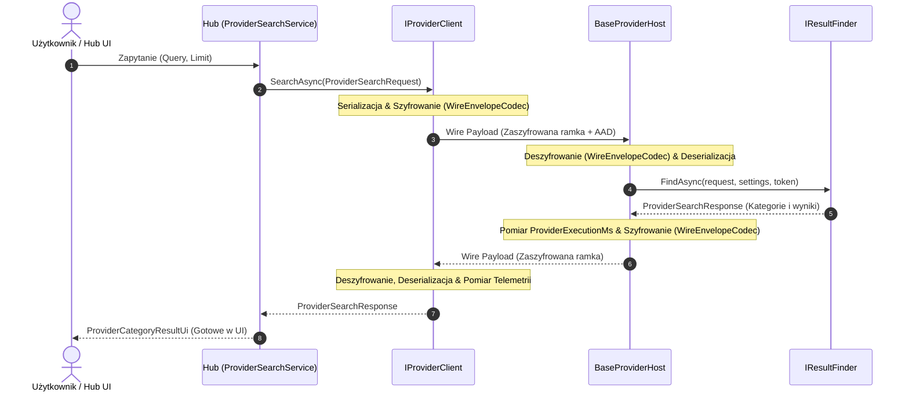

# Komunikacja z Dostawcami (Communication Guide)

## 1. Wstęp
Dawniej komunikacja w projekcie opierała się w 100% na protobufie z centralnym `GenericMessage`. Po ogromnym refaktoringu projekt używa architektury wielotransportowej (multi-transport). Wiele protokołów jest wspieranych jednocześnie, w zależności od tego, jak zostanie zainicjowany `BaseProviderHost`.

Obecnie wspierane transporty to:
- **Named Pipes**: Używa serializacji w formacie `System.Text.Json`. Zapewnia najszybszą komunikację z lokalnymi procesami.
- **gRPC**: Tradycyjne połączenie oparte o protokoły Protobuf. Użyteczne do komunikacji międzyserwerowej lub procesów wymagających ścisłych kontraktów.
- **HTTP**: Domyślna komunikacja w formacie REST / JSON.

Wszystkie te transporty są obsługiwane i obudowane przez pakiet `BaseProvider`. Dostawca implementuje generyczny interfejs `IResultFinder<TSettings>`, a za transport i kodowanie odpowiadają fabryki oraz klasy takie jak `TransportMessageCodec.cs` i `ProviderTransportFactory.cs`.

## 2. Modele Danych
Wspólne kontrakty komunikacyjne (`ProviderSearchRequest`, `ProviderSearchResponse`, `ProviderResultCategory`, `ProviderResultItem`, `ProviderSettingsBase`) są zdefiniowane w `Shared/WindowsSearch.Common/Models/`, nie w `Providers/BaseProvider/Models/`.

Najważniejsze kontrakty:
- `ProviderSearchRequest`: zawiera dane o zapytaniu (`Query`), limicie (`Limit`), budżecie czasowym na odpowiedź (`TimeoutMs`) oraz `SettingsYaml` - bieżący snapshot typowanych ustawień dostawcy (zserializowany do YAML), wysyłany przy każdym zapytaniu tak, aby edycja ustawień w Hub działała bez restartu procesu dostawcy. Zobacz `SETTINGS_GUIDE.md`.
- `ProviderSearchResponse`: zwracany do huba, zawiera listę `ProviderResultCategory`.
- `ProviderResultCategory`: grupuje wyniki, zawiera kolekcję `ProviderResultItem`.
- `ProviderResultItem`: pojedynczy obiekt reprezentujący wynik z tytułem, podtytułem, ikoną i akcjami.
- `ProviderSettingsBase`: bazowy, typowany i walidowany model ustawień (transport/endpoint/serializacja/timeout/log level). Każdy dostawca ma własną podklasę we własnym projekcie `<Nazwa>.Settings` - szczegóły w `SETTINGS_GUIDE.md`.

## 3. Abstrakcja Transportu
Zamiast ręcznego pisania nasłuchiwania w pętli na `NamedPipeServerStream`, `BaseProvider` używa modelu opartego na interfejsach:
- `IProviderTransport` - interfejs implementowany przez poszczególne warstwy transportu (`NamedPipeProviderTransport`, `GrpcProviderTransport`, `HttpProviderTransport`).
- `IProviderTransportFactory` - tworzy odpowiedni transport na podstawie przekazanych flag i preferencji podczas startu programu.

Większość nowo tworzonych dostawców nie musi bezpośrednio modyfikować protokołu komunikacji. Wszystko jest spakowane w `BaseProviderHost.RunAsync(...)`.

### 3.1. Optymalizacja i Bezpieczeństwo NamedPipe (`PipeFrameCodec`)
Komunikacja przez potoki nazwane (NamedPipe) wykorzystuje współdzieloną klasę `PipeFrameCodec` (`WindowsSearch.Common.Pipes`):
- **Bezpieczeństwo**: Wymuszenie `PipeOptions.CurrentUserOnly` po stronie serwera i klienta zapobiega atakom typu *pipe squatting* i podsłuchowi międzyużytkownikowemu w Windows.
- **Zero-Allocation**: Wykorzystanie buforów `ArrayPool<byte>.Shared` oraz `BinaryPrimitives` eliminuje alokacje na stercie GC przy kodowaniu 4-bajtowych nagłówków długości.
- **Ochrona DoS**: Weryfikacja limitu rozmiaru ramki (`DefaultMaxMessageSize = 16 MB`) chroni przed przepełnieniem pamięci.
- **Wydajność I/O**: Połączenie nagłówka i danych w jedną operację zapisu (`stream.WriteAsync`) oraz jawne bufory jądra Windows (64 KB) minimalizują przełączanie kontekstu wątków.

### 3.2. Warstwa Szyfrowania Wiadomości (`WireEnvelopeCodec`)
Każdy transport (Named Pipe, HTTP, gRPC) przekazuje zserializowaną wiadomość przez uniwersalny kodek szyfrujący `WireEnvelopeCodec` (`WindowsSearch.Common.Security`):
- **Hermetyzacja Ramki**: Każda wiadomość sieciowa jest pakowana w binarną kopertę z 1-bajtową wersją protokołu (`0x01`) oraz 1-bajtowym identyfikatorem algorytmu (`EncryptionKind`).
- **Zarządzanie Ustawieniami**: Tryb szyfrowania jest konfigurowany w `ProviderSettings.Encryption` (wartości: `None`, `Aes128Gcm`, `Aes256Gcm`, `Aes256Ccm`, `Aes256CbcHmac`, `ChaCha20Poly1305`).
- **Współdzielenie Kluczy**: Klucz symetryczny jest zarządzany za pośrednictwem Windows DPAPI (`KeyManager.GetOrCreateMasterKey()`) i nie jest przesyłany otwartym tekstem w argumentach CLI.
- **Szczegóły kryptograficzne**: Pełny opis formatu binarnego, algorytmów oraz zabezpieczeń znajduje się w `.copilot/SECURITY_GUIDE.md`.
